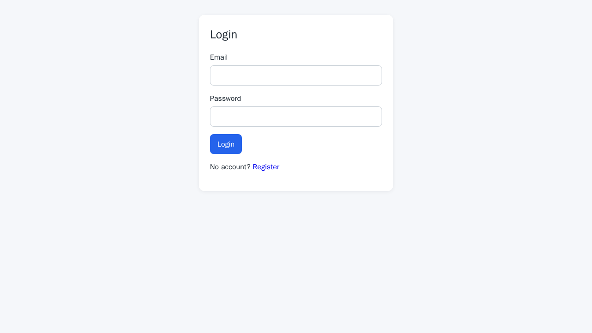
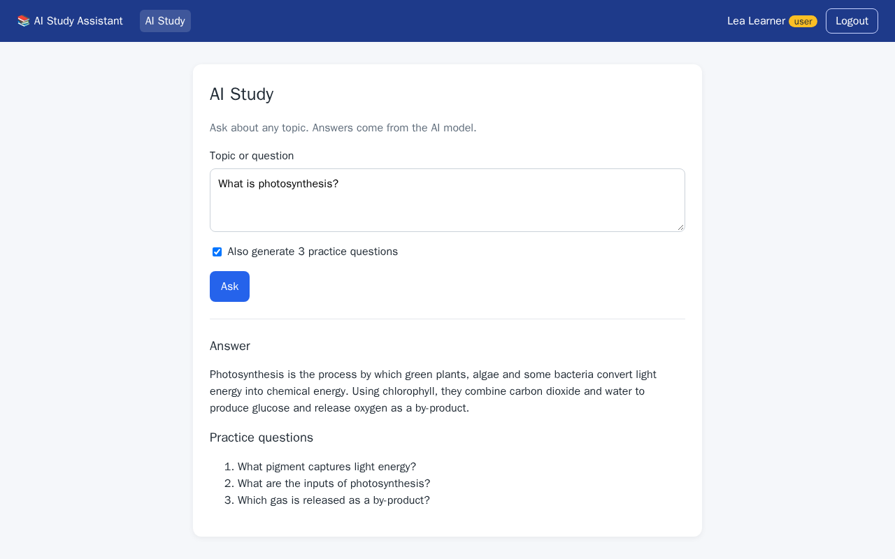
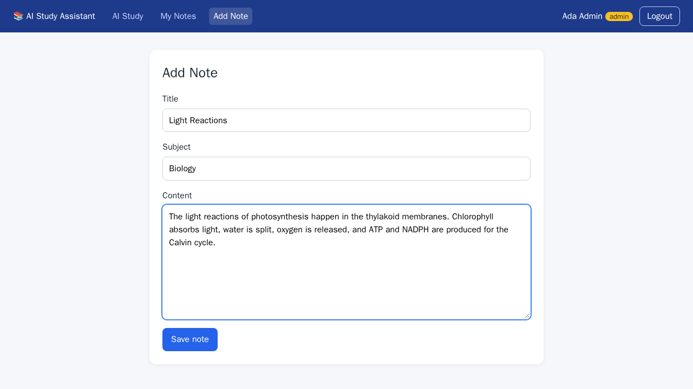
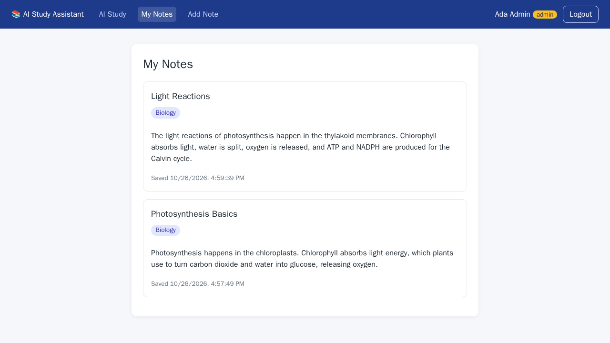
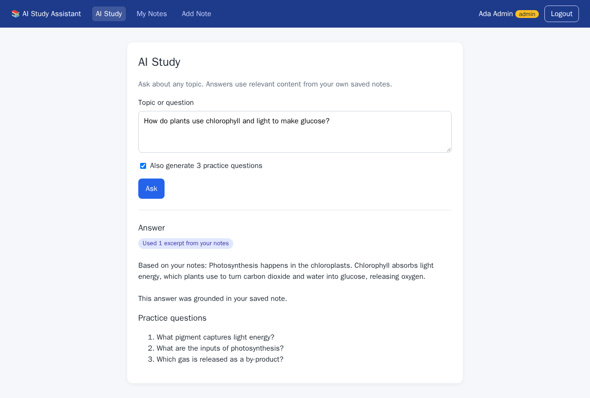
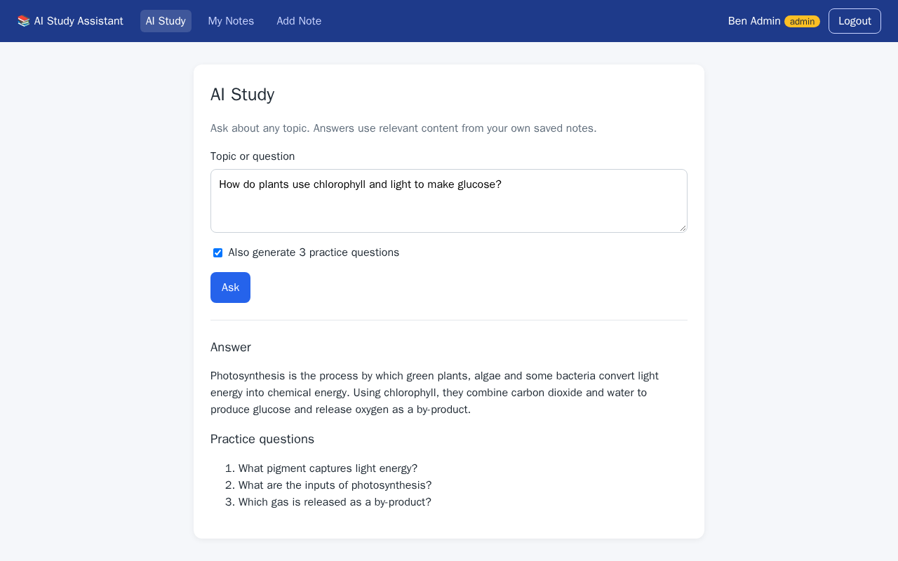
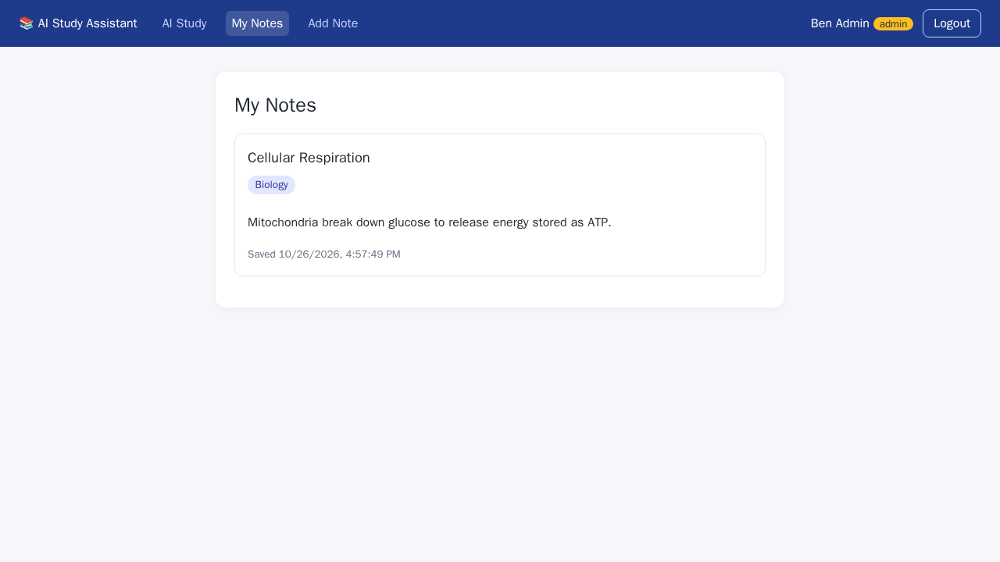

# AI Study Assistant

A small full-stack app where **admins** save private study notes and **any logged-in learner** asks AI-powered study questions. It reuses the Kitchen Assistant patterns: Express + Mongoose, bcrypt + JWT auth, `requireAuth` / `requireAdmin` middleware, Ollama chat and embeddings (`llm.js`, `rag.js`), and a React (Vite) frontend with route guards.

## Features

- **Register / Login**: name, email, and password are validated. Passwords are hashed with bcrypt, and login returns a JWT.
- **Roles**: `user` (learner) and `admin`. Public registration always creates a `user`. Admins are promoted with a script (see below).
- **Admin notes**: admins create notes (title, subject, content). `createdBy` is taken from the JWT, never from the request body. **My Notes** lists only the caller's notes.
- **AI Study**: any logged-in user asks a question. Ollama returns an answer and, optionally, 3 practice questions.
- **Private RAG**: each note is embedded into `NoteChunk`s. For admins, the backend retrieves the most relevant chunks **from that admin's own notes only** (filtered by `createdBy`) and adds them to the prompt. Learners get a plain LLM answer with no note context.

## Tech stack

| Layer | Tech |
|---|---|
| Frontend | React 19, Vite, react-router-dom 7, axios |
| Backend | Node 20+, Express 5, Mongoose, bcrypt, jsonwebtoken, cors, dotenv |
| Data / AI | MongoDB, Ollama (`qwen2.5:7b` chat, `nomic-embed-text` embeddings) |

## Project structure

```
backend/
  src/
    server.js, app.js, db.js, llm.js, rag.js
    models/        User.js, Note.js, NoteChunk.js
    middleware/    auth.js            (requireAuth, requireAdmin)
    controllers/   authController.js, notesController.js, studyController.js
    routes/        authRoutes.js, notesRoutes.js, studyRoutes.js
  scripts/makeAdmin.js
  tests/api.test.js
frontend/
  src/
    api.js                 axios instance + JWT interceptor
    context/AuthContext.jsx
    components/Guards.jsx  GuestOnly / RequireAuth / RequireAdmin
    components/Header.jsx  nav shown only when logged in, admin links only for admins
    pages/                 Login, Register, Study, MyNotes, AddNote
docs/screenshots/          walkthrough images
```

## Setup

### Prerequisites

- Node.js 20+
- MongoDB running locally (or a MongoDB Atlas URI)
- [Ollama](https://ollama.com) running locally, with the models pulled:
  ```bash
  ollama pull qwen2.5:7b
  ollama pull nomic-embed-text
  ```

### Backend

```bash
cd backend
cp .env.example .env      # then set jwtSecret to a long random string
npm install
npm start                 # http://localhost:3000  (npm run dev for --watch)
```

Create an admin: register the account in the UI (or with `POST /auth/register`), then run:

```bash
npm run make-admin -- admin@example.com
```

### Frontend

```bash
cd frontend
cp .env.example .env
npm install
npm run dev               # http://localhost:5173
```

## Environment variables

These are names only. Never commit real secrets. Each `.env` file is gitignored.

**backend/.env**

| Name | Purpose | Example / default |
|---|---|---|
| `PORT` | API port | `3000` |
| `mongoURI` | MongoDB connection string | `mongodb://localhost:27017/study-assistant` |
| `jwtSecret` | Secret used to sign JWTs (**required**) | *(your own random string)* |
| `jwtExpiresIn` | Token lifetime | `1h` |
| `clientOrigin` | Allowed CORS origin | `http://localhost:5173` |
| `ollamaUrl` | Ollama base URL | `http://localhost:11434` |
| `chatModel` | Ollama chat model | `qwen2.5:7b` |
| `embedModel` | Ollama embedding model | `nomic-embed-text` |
| `ragMinScore` | Minimum cosine similarity for a chunk to be used | `0.5` |

**frontend/.env**

| Name | Purpose | Example |
|---|---|---|
| `VITE_API_URL` | Backend base URL | `http://localhost:3000` |

## API

| Method | Endpoint | Access | Purpose |
|---|---|---|---|
| POST | `/auth/register` | public | Create a learner account `{ name, email, password }` |
| POST | `/auth/login` | public | Returns `{ token, user }` |
| GET | `/auth/me` | logged in | Current user (used to revalidate a stored session) |
| GET | `/notes` | admin | List **own** notes |
| POST | `/notes` | admin | Save and index a note `{ title, subject, content }` |
| POST | `/study/ask` | logged in | `{ question, includeQuiz? }` → `{ answer, practiceQuestions, usedNotes }` |
| POST | `/study/quiz` | logged in | `{ topic }` → `{ questions: [3], usedNotes }` |

Missing or invalid tokens return `401`. Learners calling `/notes` get `403`.

## Pages and permissions

| Page | Logged out | Learner | Admin |
|---|---|---|---|
| Login / Register | ✅ | redirected to AI Study | redirected to AI Study |
| AI Study | redirected to Login | ✅ | ✅ (uses own notes) |
| My Notes | redirected to Login | redirected to AI Study | ✅ own notes only |
| Add Note | redirected to Login | redirected to AI Study | ✅ |

## Tests

The backend tests cover the acceptance checklist: hashing, validation, JWT, 401/403 responses, `createdBy` filtering, and cross-admin RAG isolation. Ollama is mocked in the tests, so they need MongoDB but not Ollama.

```bash
cd backend
npm test                                    # uses an in-memory MongoDB
# or against a running MongoDB:
TEST_MONGO_URI=mongodb://localhost:27017/study-assistant-test npm test
```

## Walkthrough: learner vs. admin

> **Note:** these screenshots were taken in a sandbox that could not download Ollama. A small local stand-in for the Ollama HTTP API (`/api/chat`, `/api/embed`) produced the AI text. With real Ollama, the app works the same, but the answers will be written by `qwen2.5:7b`.

Demo accounts used: **Lea** (learner), **Ada** (admin), **Ben** (admin).

1. **Logged out.** Opening `/study` redirects to Login. No navigation bar is shown.
   

2. **Learner (Lea).** The nav shows only *AI Study*. Asking "What is photosynthesis?" returns an answer and 3 practice questions, with no note context. Visiting `/notes` redirects back to `/study`, and the API returns `403`.
   

3. **Admin (Ada) adds a note.** The nav also shows *My Notes* and *Add Note*.
   

4. **Ada's My Notes** lists only notes she created.
   

5. **Ada asks a question.** Relevant chunks from *her* notes are retrieved, and the badge shows how many excerpts were used.
   

6. **Admin (Ben) asks the same question.** None of Ada's notes are used, because retrieval is filtered by Ben's user ID. He gets a general answer.
   

7. **Ben's My Notes** shows only his own note. Ada's notes are not visible.
   

## Security notes

- Passwords are hashed with bcrypt (cost 10) and never returned by the API.
- The role is never accepted from the client during registration.
- `createdBy` and the RAG owner filter both come from the verified JWT user.
- Note chunks store `createdBy` too, so retrieval queries only the caller's chunks.
- Request bodies are limited to 100 KB, and CORS is restricted to `clientOrigin`.
